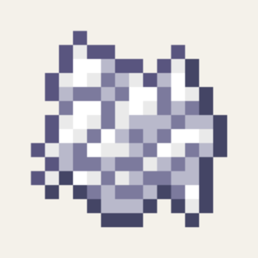

<p align="center"></p>

<h1 align="center">🦴 BoneBone</h1>

<p align="center"><b>Grow what you want with a single bone meal.</b></p>

<p align="center">
  
  
  
  
  
  <a href="https://github.com/tariksharabaty/o-lib"></a>
  <a href="https://modrinth.com/organization/oidioomstudio"></a>
  <a href="https://oidioom.com"></a>
</p>

<p align="center"><a href="#-english">🇬🇧 English</a> · <a href="#-türkçe">🇹🇷 Türkçe</a></p>

---

## 🇬🇧 English

> [!IMPORTANT]
> Requires **[O Lib](https://github.com/tariksharabaty/o-lib)** and **Fabric API**.

**BoneBone** gives server administrators and players granular control over Minecraft's bone meal mechanics. In vanilla, bone meal is an all-or-nothing system that can disrupt game balance, ruin custom landscaping, or leave crops like Cactus and Sugar Cane out in the cold. **BoneBone fixes that.**

---

## ✨ Key Features

- 🌾 **Granular Plant Control:** Toggle bone meal growth on/off for **every single vanilla and modern 26.x crop**, sapling, mushroom, flower, and moss individually!
- 🌵 **Extra Bone Meal Support:**
  - **Cactus:** Grow cactus up to 3 blocks tall using bone meal!
  - **Sugar Cane:** Grow sugar cane up to 3 blocks tall using bone meal!
  - **Nether Wart:** Mature Nether Wart stages using bone meal!
- 🌸 **Latest 26.x Flora Supported:** Full support for Pale Oak saplings, Pale Moss, Eyeblossoms (Open/Closed), Wildflowers, Leaf Litter, and Cactus Flowers.
- 🍃 **Selective Grass Block Bonemealing:** Disable specific weed or flower spawns when bone-mealing grass blocks.
- ⚙️ **Instant Stone UI Config:** Fine-tune every single plant category live in-game through **O Lib** and ModMenu.

---

## 📋 Configurable Categories

1. **Crops:** Wheat, Carrots, Potatoes, Beetroots, Melons, Pumpkins, Torchflower, Pitcher Plant, Cocoa Beans.
2. **Saplings & Fungi:** Oak, Spruce, Birch, Jungle, Acacia, Dark Oak, Cherry, Pale Oak, Mangrove, Brown/Red Mushrooms, Crimson/Warped Fungus, Shelf Mushrooms.
3. **Special Flora:** Bamboo, Sweet Berries, Firefly Bush, Cave Vines, Twisting/Weeping Vines, Azalea, Moss & Pale Moss, Rooted Dirt, Crimson/Warped Nylium, Dripleaf, Kelp, Seagrass, Sea Pickles, Glow Lichen.
4. **Extra Mechanics:**
   - `extraCactus`: Allow bone-mealing cactus (Default: true)
   - `extraSugarCane`: Allow bone-mealing sugar cane (Default: true)
   - `extraNetherWart`: Allow bone-mealing nether wart (Default: true)

---

## 📥 Installation

1. Install **Minecraft 26.3** with **Fabric Loader**.
2. Install **Fabric API**.
3. Install **O Lib** (required core library).
4. Drop `bonebone-1.1.2-mc26.3.jar` into your `mods` folder.

---

## ⬇️ Download

- **Modrinth:** [Oidioom Studio](https://modrinth.com/organization/oidioomstudio)
- **GitHub Releases:** [`bonebone-1.1.2-mc26.3.jar`](../../releases/latest)

## 🔨 Building from source

Requires **JDK 25**.

```bash
# 1) O Lib is a dependency — publish it to your local Maven first
git clone https://github.com/tariksharabaty/o-lib.git
(cd o-lib && ./gradlew publishToMavenLocal)

# 2) build this mod
./gradlew build
# output: build/libs/bonebone-1.1.2-mc26.3.jar
```

## 📄 License

[MIT](LICENSE) © 2026 Oidioom / Tarek Sharabaty

---

## 🇹🇷 Türkçe

**Tek bir kemik tozuyla istediğinizi büyütün ve her bitkiyi tek tek kontrol edin.**

> [!IMPORTANT]
> **[O Lib](https://github.com/tariksharabaty/o-lib)** ve **Fabric API** gerektirir.

### ✨ Özellikler

- Tüm vanilla ve 26.x bitkileri için ayrı ayrı kemik tozu açma/kapama
- Ek bitkilere kemik tozu desteği
- Pale Oak, Eyeblossom, Wildflowers gibi en yeni 26.x bitkileri
- Çimen bloklarında istenmeyen ot/çiçek çıkışını kapatma
- O Lib ile anında oyun içi ayar

### 📥 Kurulum

1. **Minecraft 26.3** için **Fabric Loader** kurun.
2. **Fabric API** ve **O Lib** modlarını `mods` klasörüne ekleyin.
3. `bonebone-1.1.2-mc26.3.jar` dosyasını `mods` klasörüne atın ve oyunu başlatın.

### ⬇️ İndir

- **Modrinth:** [Oidioom Studio](https://modrinth.com/organization/oidioomstudio)
- **GitHub Releases:** [`bonebone-1.1.2-mc26.3.jar`](../../releases/latest)

### 📄 Lisans

[MIT](LICENSE) © 2026 Oidioom / Tarek Sharabaty

---

<p align="center"><a href="https://oidioom.com"></a></p>
<p align="center"><b>by Oidioom — Tarek Sharabaty</b><br>
<a href="https://oidioom.com">oidioom.com</a> · <a href="https://github.com/tariksharabaty">GitHub</a> · <a href="https://modrinth.com/organization/oidioomstudio">Modrinth</a> · <a href="https://gear.oidioom.com">Gear</a> · <a href="https://www.instagram.com/oidioom">Instagram</a></p>
